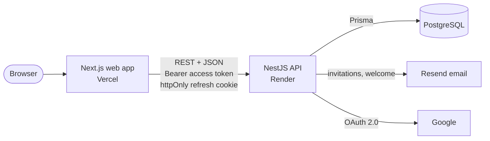
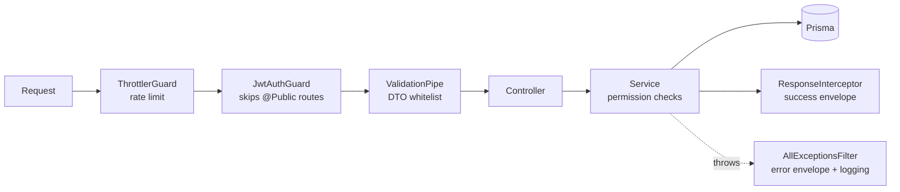

# ProjectFlow API

[](https://github.com/juanjosegl/projectflow-api/actions/workflows/ci.yml)


REST API for **ProjectFlow**, a team task manager with kanban boards, role-based permissions, email invitations, comments and notifications.

| | |
| --- | --- |
| **Live demo** | https://projectflow-web-rho.vercel.app (one click, no sign-up) |
| **API docs (Swagger)** | https://projectflow-api-iyet.onrender.com/api/docs |
| **Frontend repo** | [projectflow-web](https://github.com/juanjosegl/projectflow-web) |

> The API runs on Render's free tier and sleeps after ~15 idle minutes, so the first request can take up to a minute.

## Highlights

- **Layered NestJS architecture**: one module per domain (auth, teams, projects, tasks, comments, notifications, dashboard). Controllers stay thin and services own the business rules.
- **Authorization on the server**: every request is checked against team membership and role (admin, manager, developer). No client-side trust.
- **Secure session handling**: a 15-minute access JWT plus a refresh token in an `httpOnly` cookie. The refresh token is **rotated on every use**, stored only as a SHA-256 hash, compared in constant time, and revoked on logout.
- **Defense in depth**: DTO validation that rejects unknown fields, rate limiting with stricter limits on the credential endpoints, security headers (Helmet), env validation at boot, and errors that never leak internals.
- **Consistent contract**: every response is `{ success, data, timestamp }` and every error is `{ success: false, statusCode, message, path, timestamp }`. Prisma errors are mapped to proper 4xx codes.
- **Tested at two levels**: Jest unit tests for the permission rules, plus an end-to-end smoke test that CI runs against a real PostgreSQL on every push.

## Tech stack

| Concern | Choice | Why |
| --- | --- | --- |
| Framework | NestJS 11 (TypeScript) | Modules, dependency injection and guards make the auth and permission layers explicit |
| Database | PostgreSQL 16 + Prisma 6 | Relational data (teams → projects → tasks), type-safe queries, versioned migrations |
| Auth | Passport (JWT + Google OAuth 2.0), bcrypt | Standard, well-audited strategies |
| Validation | class-validator DTOs | Declarative rules next to the types they protect |
| Security | Helmet, @nestjs/throttler | Security headers and brute-force protection |
| Email | Resend | Invitations and welcome emails; optional in development |
| Docs | Swagger / OpenAPI | Interactive reference generated from the code |
| Testing | Jest, Node smoke test, GitHub Actions | Fast unit feedback plus a real-database end-to-end check |

## Architecture



Each request goes through the same pipeline:



The [architecture notes](docs/architecture.md) cover the data model (ER diagram), the session and refresh-token flow, and the main design decisions.

## Domain and permissions

```
User ─┬─ TeamMember (ADMIN | MANAGER | DEVELOPER) ─ Team ─ Project ─ Task ─ Comment
      └─ Notification (task assigned, status changed, new comment, team invitation)
```

| Action | Admin | Manager | Developer |
| --- | :-: | :-: | :-: |
| View team, projects and tasks; create and move tasks; comment | ✓ | ✓ | ✓ |
| Invite members, create and edit projects | ✓ | ✓ | |
| Change roles, remove members, delete projects | ✓ | | |
| Delete a task | ✓ | ✓ | only their own |

Business rules enforced by the services:

- A team always keeps at least one admin (you cannot demote, remove or leave as the last one).
- Tasks can only be assigned to members of the project's team.
- Invitations expire after 7 days and can only be accepted by the account whose email they were sent to.
- Notifications go to the assignee when someone else assigns, moves or comments on their task.

## Project structure

```
src/
  auth/            login, register, Google OAuth, refresh rotation; Passport strategies
  teams/           teams, members, roles, invitations
  projects/        projects inside a team
  tasks/           kanban tasks: status, position, assignee, due date
  comments/        task comments
  notifications/   in-app notifications
  dashboard/       personal and team statistics
  users/ upload/   profile and avatar upload
  email/           Resend wrapper (logs instead of sending when not configured)
  common/          global guard, decorators, error filter, response interceptor
  config/          environment validation
  prisma/          PrismaService
  demo-reset.service.ts   rebuilds the shared demo team on boot
prisma/
  schema.prisma    data model
  migrations/      versioned SQL migrations
  seed.ts          demo team (3 users, 2 projects, 13 tasks)
test/
  smoke.mjs        end-to-end checks against a running API
```

## Getting started

**Requirements:** Node.js 20+ and PostgreSQL 16. If you have Docker, this starts a database:

```bash
docker run -d --name projectflow-db -e POSTGRES_PASSWORD=postgres -e POSTGRES_DB=projectflow -p 5432:5432 postgres:16
```

Then:

```bash
cp .env.example .env          # set DATABASE_URL and two different JWT secrets
npm install
npx prisma migrate deploy
npm run db:seed               # demo team, 2 projects, 13 tasks
npm run dev                   # http://localhost:3001/api/v1 · docs at /api/docs
```

Demo accounts (password `Password123!`): `alice@projectflow.dev` (admin), `bob@projectflow.dev` (manager), `carlos@projectflow.dev` (developer).

### Environment variables

The API refuses to start if a required variable is missing, and lists all of them in one error.

| Variable | Required | Description |
| --- | :-: | --- |
| `DATABASE_URL` | ✓ | PostgreSQL connection string |
| `JWT_SECRET` / `JWT_REFRESH_SECRET` | ✓ | Signing secrets for access and refresh tokens; must differ. Generate with `openssl rand -hex 32` |
| `JWT_EXPIRES_IN` / `JWT_REFRESH_EXPIRES_IN` | ✓ | Token lifetimes, e.g. `15m` and `7d` |
| `FRONTEND_URL` | ✓ | Web app origin, used for CORS and the OAuth redirect |
| `GOOGLE_CLIENT_ID` / `GOOGLE_CLIENT_SECRET` / `GOOGLE_CALLBACK_URL` | ✓ | Google OAuth; any non-empty value boots the API, real values enable Google sign-in |
| `PORT` | | Defaults to `3001` |
| `RESEND_API_KEY` | | Without it, emails are logged instead of sent |
| `APP_URL` | | Base URL used in email links; defaults to `http://localhost:3000` |
| `DEMO_RESET_ON_BOOT` | | `true`/`false`; rebuilds the demo team on boot. Defaults to `true` on Render and `false` elsewhere |

### Scripts

| Script | What it does |
| --- | --- |
| `npm run dev` | Start with hot reload |
| `npm run build` / `npm start` | Compile to `dist/` and run it |
| `npm run lint` / `npm run format` | ESLint (type-aware) and Prettier |
| `npm run typecheck` | TypeScript without emitting |
| `npm test` / `npm run test:cov` | Unit tests, optionally with coverage |
| `npm run test:smoke` | End-to-end smoke test against a running API |
| `npm run db:migrate` / `db:seed` / `db:studio` | Create a migration, seed demo data, open Prisma Studio |

## Testing

**Unit tests** (`npm test`) cover the code where a bug would be a security or data problem: who can invite, change roles, remove members and delete tasks; the last-admin rule; invitation checks; when notifications are sent; how errors are mapped; and environment validation. Prisma is mocked, so they run in seconds.

**Smoke test** (`npm run test:smoke`) runs against a live API and a seeded database. It checks access control between teams, refresh-token rotation and revocation, task assignment rules, notifications, invitations, the last-admin rule, the error envelope, security headers and login rate limiting.

**CI** runs lint, type check, unit tests, build, migrations, seed and the smoke test against PostgreSQL 16 on every push and pull request. The web repo's CI also runs a Playwright test against this API.

## API conventions

- Base path: `/api/v1`. Authenticate with `Authorization: Bearer <accessToken>`.
- Successful responses: `{ "success": true, "data": …, "timestamp": "…" }`.
- Errors: `{ "success": false, "statusCode": 404, "message": "Task not found", "path": "…", "timestamp": "…" }`. Validation errors return `message` as a list.
- Rate limits: 100 requests per minute per IP, and 10 per minute on `/auth/login` and `/auth/register`. Over the limit you get `429`.

| Method | Route | Description |
| --- | --- | --- |
| POST | `/auth/register`, `/auth/login` | Create an account or sign in |
| POST | `/auth/refresh`, `/auth/logout` | Rotate or revoke the refresh cookie |
| GET | `/auth/google` | Google sign-in |
| GET / POST | `/teams` | My teams / create a team |
| POST | `/teams/:id/invite` | Invite by email |
| POST | `/teams/invitations/:token/accept` · `/decline` | Answer an invitation |
| PATCH / DELETE | `/teams/:id/members/:memberId[/role]` | Change a role / remove a member |
| GET / POST | `/teams/:id/projects` | Projects of a team |
| GET / POST | `/projects/:id/tasks` | Board tasks |
| PATCH / DELETE | `/tasks/:id` | Move, reassign, reschedule, edit / delete |
| GET / POST | `/tasks/:id/comments` | Comments |
| GET | `/dashboard/me`, `/dashboard/teams/:id` | Statistics |
| GET / PATCH | `/notifications`, `/notifications/:id/read` | My notifications |
| GET | `/health` | Liveness and database check |

The full, interactive reference is in [Swagger](https://projectflow-api-iyet.onrender.com/api/docs).

## Deployment

The API runs on Render as a Node web service:

| Setting | Value |
| --- | --- |
| Build command | `npm install --include=dev --legacy-peer-deps --ignore-scripts && ./node_modules/.bin/prisma generate && npm run build && ./node_modules/.bin/prisma migrate deploy` |
| Start command | `node dist/src/main` |
| Health check | `/api/v1/health` |

`--include=dev` is required because Render sets `NODE_ENV=production`, which would otherwise skip the build tools. Migrations run during the build, so a failed migration never replaces the running version.

The demo accounts are shared by every visitor, so on Render the API rebuilds the demo team each time it boots. Data that belongs to other users is never touched.

## Known limitations and next steps

- **One session per user.** The refresh token hash lives on the user row, so signing in on a second device ends the first session. A `sessions` table would allow several devices and a "sign out everywhere" option.
- **Avatars are stored as data URLs in the database** (max 2 MB, PNG/JPEG/WebP/GIF). That is fine at this scale; object storage (S3, R2) would be the next step.
- **No pagination yet** on list endpoints; teams and boards are small. Notifications are capped at the latest 50.
- **Prisma 7** removes the deprecated `package.json#prisma` seed config. The upgrade is pending.

## License

[MIT](LICENSE)
