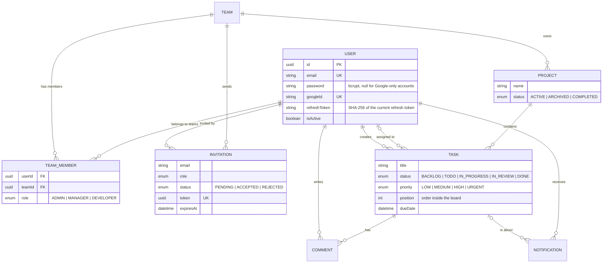
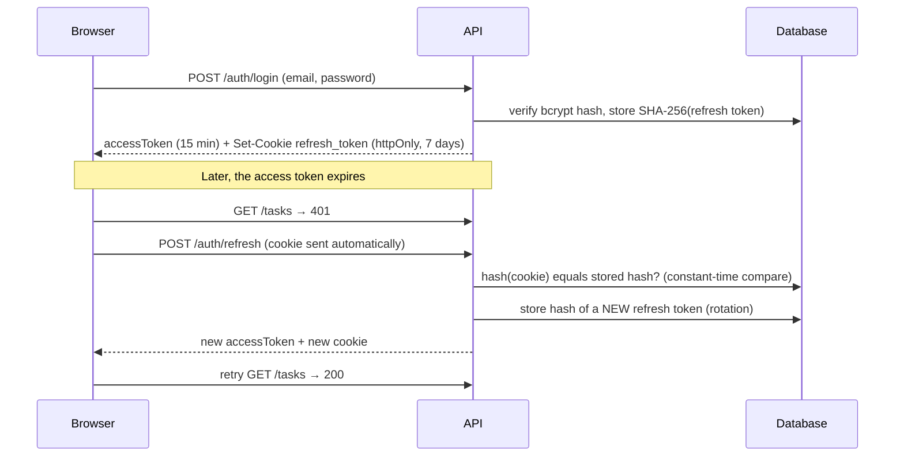

# Architecture notes

These notes explain how ProjectFlow's API is put together and why. Setup and usage are in the [README](../README.md).

## Data model

- **Membership is the security boundary.** A `TeamMember` row is what gives a user access to a team's projects, tasks and comments, and its `role` decides what they can change. Every service method resolves the membership before it touches data.
- **Deleting a team or project cascades** to its projects, tasks, comments and invitations. Notifications keep their history: `taskId` is set to null when the task is deleted.
- **Indexes** cover the foreign keys used by the hot queries: tasks by project and position (the board), tasks by assignee and status (dashboard, "my tasks"), comments by task, notifications by user and date, and members by team.

## Authentication and sessions

Design choices:

- **Short-lived access token, long-lived refresh cookie.** The access token is sent as a bearer header, so the API is stateless for normal requests. The refresh token never reaches JavaScript (`httpOnly`), which keeps it out of reach of XSS.
- **Rotation with reuse detection.** Each refresh replaces the stored hash, so a stolen refresh token stops working as soon as the real user refreshes, and an old token is rejected. Logout clears the hash.
- **Hash, don't encrypt.** Refresh tokens are high-entropy random JWTs, so a plain SHA-256 digest is enough. bcrypt would be wrong here: it only reads the first 72 bytes, and every token of a user shares that prefix.
- **Cross-site cookie.** The web app (Vercel) and the API (Render) are on different sites, so in production the cookie is `SameSite=None; Secure`. A shared custom domain would allow `SameSite=Lax`.
- **Google sign-in** links accounts by email only when Google reports the address as verified. The access token comes back to the web app in the URL fragment (`#token=…`), which browsers never send to servers or put in `Referer` headers.
- **Account deactivation is immediate.** `JwtStrategy` loads the user on every request, so setting `isActive = false` blocks the next request instead of waiting for the token to expire.

## Request pipeline

Global providers are registered in `AppModule` (not in `main.ts`), so they take part in dependency injection and apply the same way in tests:

| Order | Provider | Responsibility |
| --- | --- | --- |
| 1 | `ThrottlerGuard` | 100 requests/min per IP; 10/min on login and register |
| 2 | `JwtAuthGuard` | Requires a valid access token unless the route is `@Public()` |
| 3 | `ValidationPipe` | Validates DTOs, strips and rejects unknown fields, converts types |
| 4 | Controller → Service | Services check membership and role, then run the Prisma queries |
| 5 | `ResponseInterceptor` | Wraps results as `{ success: true, data, timestamp }` |
| — | `AllExceptionsFilter` | Turns any error into `{ success: false, … }`, maps Prisma errors to 4xx and logs 5xx with the stack trace |

`main.ts` only does HTTP-level setup: Helmet, cookies, CORS, the `/api/v1` prefix, `trust proxy` (so rate limiting sees the client IP behind Render's proxy), shutdown hooks and Swagger.

## The shared demo

The live demo signs every visitor in as the same admin, so their changes would pile up. `DemoResetService` rebuilds the demo team inside one transaction each time the API boots. On Render's free tier the service sleeps after ~15 idle minutes, so in practice every new visitor gets clean data. The reset only touches the three demo users and the teams that contain nobody else.
